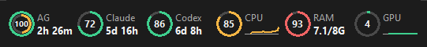
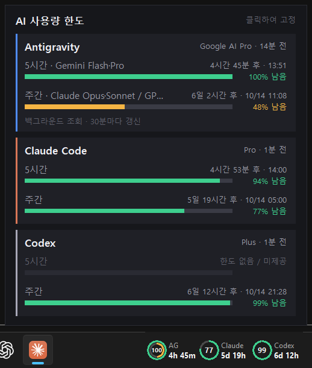

# AI quota-ring

Windows taskbar widget showing the remaining **5-hour / weekly usage limits** of
**Antigravity**, **Claude Code** and **Codex** as small rings, with time until reset.

Antigravity · Claude Code · Codex 의 5시간/주간 사용량 한도를 작업표시줄에 원형 그래프로 보여주는 Windows 위젯입니다.

<p>
  <br>
  
</p>

## 기능

- **작업표시줄 바** — 도구별 주간 잔량(원)과 리셋까지 남은 시간
  - Antigravity 는 이중 원: 바깥 = Gemini, 안쪽 = Claude·GPT (숫자·시간은 Gemini 기준)
  - 잔량 50% 이상 초록, 20% 이상 주황, 그 미만 빨강
- **시스템 사용량** — CPU(미니 그래프) · RAM(사용/전체 GB) · GPU(미니 그래프, VRAM) 를 2초마다 표시
  - 외부 프로세스 없이 Win32 API · 성능 카운터로 측정 (사용률 60% 미만 초록, 85% 미만 주황, 그 이상 빨강)
- **표시 항목 선택** — 우클릭 → 표시 항목 에서 6개 항목을 각각 켜고 끄기. 꺼진 AI 항목은 조회하지 않고, 시스템 항목이 모두 꺼지면 측정도 멈춤
- **상세 패널** — 바 위에 마우스를 0.7초 올리면 표시, 클릭하면 고정
- 알림 영역(트레이) 옆에 자동 배치, 드래그로 이동, 우클릭 메뉴(새로고침·위치 초기화·종료)
- 2분마다 자동 갱신, 실패 시 마지막 값을 경고와 함께 표시

## 데이터 출처

| 도구 | 방식 |
|---|---|
| Claude Code | `~/.claude/.credentials.json` 의 OAuth 토큰으로 사용량 조회. 만료 시 refresh token 으로 갱신해 파일에 다시 저장 |
| Codex | `~/.codex/auth.json` 토큰으로 사용량 조회, 실패 시 `~/.codex/sessions` 로그의 마지막 값 |
| Antigravity | 실행 중인 Antigravity 언어 서버에 조회. 꺼져 있으면 Antigravity IDE 를 최소화 상태로 잠깐 띄워 조회 후 종료(실측값이 6시간 넘게 지났을 때나 메뉴에서 요청할 때만), 실패 시 앱이 저장한 캐시 |

토큰은 각 도구의 로그인 파일에서 실행 시점에 읽습니다(Claude 토큰 갱신 시에만 원래 파일에 다시 씀). 이 저장소나 위젯 캐시(`~/.ai-token-widget/`)에는 저장하지 않습니다.

## 설치

요구 사항: Windows 10/11, Python 3.10+ (tkinter 포함), 각 도구에 로그인된 상태

```powershell
git clone https://github.com/khw1566/AI-quota-ring.git
cd AI-quota-ring
powershell -ExecutionPolicy Bypass -File install.ps1      # 시작 프로그램 등록 + 실행
powershell -ExecutionPolicy Bypass -File install.ps1 -Uninstall   # 제거
```

수동 실행: `pyw widget.py` · 데이터만 확인: `python collector.py`

## 주의

- **비공식 도구**입니다. Anthropic, OpenAI, Google 과 관련이 없습니다.
- 사용하는 조회 경로는 공개 API 가 아니라서 언제든 바뀌거나 막힐 수 있습니다.
- Antigravity 는 모델별 쿼터 하나만 제공하므로, 리셋까지 남은 시간으로 5시간/주간을 추정합니다.

## License

MIT
